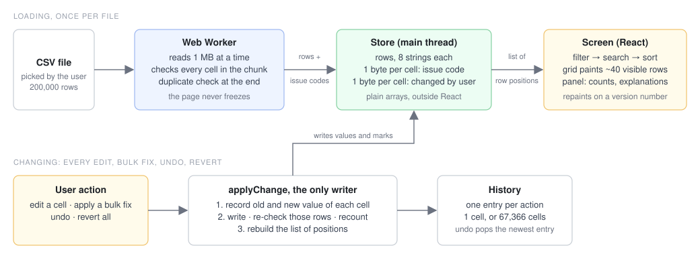

# Design document

## What this is

A review-and-fix tool for a large, messy customer CSV, for people who do not know the technical names of data problems. It loads 200,000 rows without freezing, shows every problem with a count and a plain explanation, lets the user fix values one at a time or in bulk, and keeps the file unimportable until it is clean.

## Architecture

Three ideas carry the design. Each one answers a question a reviewer would ask.

**1. The data lives in plain arrays outside React, and a row never moves.**
*Why:* React is not great at handling 200K+ objects for rendering, so the data is stored outside React.
- A row never moves (row indices do not change).
- One byte per cell for issue codes: "which problem does this cell have".
- What the user changed is kept once, next to the undo history: the value each changed cell had in the file. "Did the user change this cell?" is answered from that.
- View positions: a list of row indices produced by filter, search and sort. The grid reads through this list for rendering.
- React only watches a version counter from the store and repaints what is on the screen.

*How it helps:* an edit is one array write. A filter is one pass that produces a list of numbers. The 200k rows cost about the same whether the file is spotless or a mess.

**2. The heavy reading happens in a Web Worker, one chunk at a time.**
*Why:* parsing 15 MB on the main thread is a visible freeze, and sending all rows back from a worker in one message only moves the freeze to when the message arrives.
- The worker reads the file 1 MB at a time.
- It checks every cell of the chunk and posts the rows together with their issue codes.
- The main thread only appends and repaints.
- Duplicate emails and IDs need every row, so that check runs in the worker once parsing is done. It sends back only the row numbers to mark.

*How it helps:* the first rows are on screen about a tenth of a second after the file is picked, the progress bar moves in visible steps, and no main-thread task was longer than 50 ms in any measured run.

**3. Every change goes through one door, and that door keeps the receipt.**
*Why:* undo, "what changed" and "revert everything" are one feature seen from three sides. If edits, bulk fixes and reverts each wrote data their own way, they would drift apart.
- `applyChange` is the only function allowed to write a value.
- Before writing it records the old and new value of every cell. After writing it re-checks the touched rows, recounts and rebuilds the view.
- A typed edit is one entry with one cell. The country bulk fix is one entry with many cells. "Revert all" is one entry that writes every cell back to what the file said.
- Undo pops the newest entry and pushes the old values back through the same door.

*How it helps:* the user can try anything. A change to 67,000 cells is one click to undo, counts and colours always match the data because they are recomputed on the same path, and there is no second mechanism to keep in sync.

## Data

Everything the app keeps, how big it gets, and who writes it. "N" is the number of rows in the file (200,000 here); there are always 8 columns.

### Grows with the file

| What | Shape | Size at 200k rows | Written by | Read by |
|---|---|---|---|---|
| **Rows** `store.rows` | One array of 8 strings per row, in file order. Never reordered. | The biggest item: 1.6 million strings | Loading (append only), then `applyChange` | Grid, search, sort, checks |
| **Issue codes** `store.flags` | 8 byte arrays, one per column. `flags[column][row]` is the problem code, 0 = fine. | 8 × 256 KB = 2 MB | The worker while loading, then `applyChange` | Grid colours, counts, problem filter |
| **View** `store.view` | A list of row numbers, in the order the grid shows them. | Up to 200k × 4 bytes = 800 KB | `buildView` after every filter, search, sort or change | Grid |

The issue-code arrays start with room for 65,536 rows and double when a batch does not fit, so at 200k rows each column holds 262,144 bytes. In the benchmark (PERFORMANCE.md) a virtualized page holding the rows used about 0.26 KB of JavaScript memory per row, about 130 MB at 500,000 rows.

### Grows with what the user changes

| What | Shape | Grows by | Lives in |
|---|---|---|---|
| **Undo history** `history.undo` | One entry per user action: a label and a list of `{ row, col, oldValue, newValue }` | One item per changed cell: a typed edit adds 1, the country bulk fix adds 67,366, "Revert all" adds every changed cell | `store/changes.ts` |
| **Values from the file** `originals` | Map from cell (`row × 8 + col`) to the value the file had. The only record of what changed: it drives the green cells (`isChanged`), "was:" on hover and "Revert all". | One entry per cell ever changed; never removed until a new file loads | `store/changes.ts` |
| **Pinned rows** | Set of row numbers edited while a problem filter is on, so they stay in view | One per edited row; cleared when the filter changes | `store/query.ts` |

### Small or temporary

- **Counts** `store.counts`: one number per problem type (18 at most), plus `problemCells` and `problemRows`. Rebuilt in one pass after every change.
- **Suggestions**: for the selected problem, the rows the tool can fix and the spellings it cannot. Worked out when the panel asks, and remembered only until the next change.
- **Bulk plan**: the "USA → US, 2,895 rows" groups for the preview. Built when the preview opens; becomes one undo entry when applied.
- **Session** (`ui/session.ts`): the cell being edited, the toast and what the panel shows.

### Inside the worker, while loading

- Each 1 MB chunk becomes a batch of rows plus 8 byte arrays of issue codes. The byte arrays are handed to the main thread, not copied.
- For the duplicate check the worker keeps the email and customer ID columns (2 × N strings) until parsing ends, then sends back only the row numbers that repeat. The worker is closed when loading finishes, so this memory goes away.

### How it scales

- **Rows** are the only large cost, and they grow with the file. Everything indexed by row (issue codes, view) is a typed array of 1 to 4 bytes per row or cell.
- **Undo history and the file values** grow with the number of changed cells, not with the file. A file with no edits costs nothing here; one bulk fix on 67k cells costs 67k small entries.
- **Every pass walks all N rows once:** search, filter, counts and the duplicate re-check (sort is N log N). That is why they stay under 100 ms at 200k rows, and why work would move to a server beyond about 500k rows (see Performance).

## ADR: where parsing and validation run

**Decision:** parse and validate in a Web Worker, one chunk at a time. After that the main thread owns the data.

**Alternatives considered**
- *Everything on the main thread.* Simplest code. Parsing 15 MB freezes the page for a visible moment, longer on a slow laptop.
- *The worker keeps the data and answers every scroll, search and edit.* Scales the furthest. Every interaction becomes asynchronous and the code roughly doubles. Solves a problem we do not have at 200k to 500k rows.
- *Parse everything first, then validate in one pass at the end.* Same total work, but fifteen small slices become one block, and the first coloured cells appear later.

**Why this one, from measurements** (six parse × render combinations, 200k and 500k rows, normal and 4× / 6× slower CPU)
- Virtualization matters most: rendering every row into the DOM takes 5 to 35 s for 200k rows and never finishes for 500k.
- Among virtualized variants, parsing on the main thread is fastest on a fast laptop (0.12 s) but it is a freeze, and it grows to 0.9 s at 500k rows on a slow CPU.
- Sending all rows back from the worker in one message moves the freeze into unpacking the message.
- Chunking is the only variant with zero main-thread freezes in every run, and it shows the first rows within about 100 ms.

## UX decisions

- **One screen: a panel beside the grid.** No separate overview page and no step-by-step wizard. Both were mocked up; a wizard hides the data and takes the feeling of control away from the user, and an overview page is one more place to be.
- **Two signals, not a wall of red.** Red: cannot be imported and only the user knows the answer. Amber: the tool knows what this should be, shown inline (`Italy → IT`). Green: changed by the user, original on hover.
- **Problems are grouped, counted, explained.** The panel shows how close the file is to importable, then each problem under its column with a count, so the user works through a list instead of facing thousands of errors at once. Selecting one filters the grid and shows what is wrong, what a good value looks like, and the action, with the freedom to type a value directly.
- **Fixing feels safe.** The editor says whether the value is right as the user types. A fixed row stays in place instead of disappearing from the filtered list. Every change has undo; "Revert all changes" restores the whole file and is itself undoable.
- **Bulk is reviewed, not trusted.** The country fix shows a grouped table ("USA → US, 2,895 rows") while the amber cells behind it show every affected row; a confirm step names the number. Afterwards the grid narrows to what is left and the panel points at the next problem.
- **The tool never changes data on its own.** Loading only reads. Suggestions are computed on demand and applied only on a click.

## Performance

Apple-silicon laptop, headless Chrome, production build, 200,000 rows. Every number below, the full parse × render benchmark with 500,000 rows and CPU throttling, and the smaller measurements that decided details are in [PERFORMANCE.md](./PERFORMANCE.md).

| What | Result |
|---|---|
| Load, validate every cell, check duplicates | 0.2 s, no main-thread task over 50 ms |
| Scroll all rows | ~33 row elements in the DOM, no long tasks |
| Search / sort / filter to one problem | ~20 ms after the typing pause / ~70 ms / 15 ms |
| Save one edit | under 5 ms; ~70 ms if an email or ID changed (duplicate re-check) |
| Country bulk fix, 67,366 cells | one 57 ms task |
| 500,000 rows at 6× CPU slowdown | interactive in 0.7 s, no long tasks |

- **Parsing and per-cell checks:** run in the worker.
- **Duplicate check:** runs in the worker at load and on the main thread after an edit, only when an email or ID changed.
- **Main-thread passes:** search, sort, filter, counts and the bulk plan are single passes over typed arrays on the main thread.
- **Scaling beyond this size:** no backend is needed at this size; with millions of rows or several users, parsing, validation and the duplicate index would move to a server returning pages of rows plus counts, with the same UI on top.

## Assumptions

### Environment, scale, and budgets
- **Target environment:** modern desktop browser on a laptop-class machine; not designed for mobile.
- **Scale:** 200,000 to about 500,000 rows. Beyond that, parsing and validation would move to a server.
- **Session:** the file comes from the user's machine. Nothing is persisted; reloading the page starts over.
- **Budgets:** scrolling at 60 fps, any interaction under 100 ms, no single main-thread task over 50 ms.

### File format and validation rules
- **Schema:** all rows share one fixed column order, the one in the brief. The header row is not validated.
- **Country:** must be a two-letter code in capitals. Recognised spellings come from the browser's locale data in seven languages plus nine hand-written abbreviations. Anything else is flagged, never guessed.
- **Dates, plan, spend, names, and emails:** slash dates are day/month/year. Plan must be exactly `free`, `pro` or `enterprise`. Spend must be a plain number; negatives are flagged separately. Names and emails are checked, never trimmed or re-cased by the tool.
- **Duplicates:** both rows of a duplicate pair are flagged; the user edits either one. There is no delete.

### Workflow and interactions
- **Blocking import:** all of the data must be fixed before import; there is no partial import. Every problem is blocking.
- **Search:** case-insensitive substring match across all columns, run after a short typing pause.
- **Bulk fixes:** come from what the tool recognises; the user is not asked to enter "from → to" pairs.

## Libraries

- **PapaParse** for reading the CSV.
  - Considered: a hand-written parser (about 60 lines), `csv-parse`.
  - Chosen because: quoted commas and newlines are exactly where hand-written parsers go wrong; PapaParse handles them, streams in chunks, and reads a File inside a worker. `csv-parse` is built for Node.
- **TanStack Virtual** for the grid.
  - Considered: a full data grid (AG Grid), a canvas grid (Glide), hand-rolled virtualization.
  - Chosen because: it only reports which rows are visible and leaves everything else to us. A full grid wants to own data, sorting and filtering, which fights the position-list design, and is a large bundle. A canvas grid makes per-cell styling and inline editing harder because cells are not DOM elements. Hand-rolling re-solves scroll and resize edge cases the library already handles.
- **Plain CSS.**
  - Considered: Tailwind, a component library.
  - Chosen because: the brief asks for no visual polish, and there is nothing to set up or explain.
- **Vite, React, TypeScript, Vitest.**
  - Standard tooling. Vite bundles the worker with no configuration.

## AI note

I used claude code for the following tasks
- Comparing and benchmarking between the different rendering and data handling strategies to Base my decisions on actual measured numbers
- Building quick mockups of the UX, to get a feel of the User experinece that we can provide to the user. 
- Pairing and steering through the actual implementation of the code + Implementing tests. 

## Trade-offs and next steps

- Suggestions for other columns (plan casing, slash dates, spend formats such as `750,50` read as 750.50) use the same hook as the country fix; left out to keep to the must-haves.
- The panel as a tiered checklist with done ticks, and a results line with a "Start fixing" action when loading finishes. 
- "Remove row" for values nobody can repair: a soft delete, one byte per row, undoable.
- The duplicate re-check after an email edit is a full pass (~55 ms); an incremental index would make it instant.
- Redo was dropped on purpose; undo plus revert-all covers the need.
- An import summary screen would be the panel's list with done ticks, the readiness bar and the change history.
